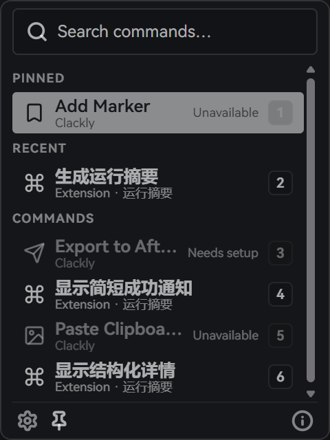

# Clackly

[简体中文](README.md)

Clackly is a lightweight command palette for DaVinci Resolve Studio.

[Download for Windows](https://github.com/Wutpeach/Clackly/releases/latest) · [Documentation](https://wutpeach.github.io/Clackly/en/docs/) · [Website](https://wutpeach.github.io/Clackly/en/)

  

## What it does

- Find built-in commands, extensions and Resolve scripts.
- Pin commands you use often and return to recent actions.
- Add your own tools with Python extensions.

## Get started

Currently supports **Windows x64** and **DaVinci Resolve Studio**.

1. Download and run the [Windows installer](https://github.com/Wutpeach/Clackly/releases/latest).
2. Load Clackly from **Workspace → Workflow Integrations → Clackly** in Resolve.

See the [installation guide](https://wutpeach.github.io/Clackly/en/docs/install/) and [first use](https://wutpeach.github.io/Clackly/en/docs/first-use/) for the full steps.

## Development

Use the official Developer Skill to build Python extensions with an AI agent.

[Build an extension](https://wutpeach.github.io/Clackly/en/docs/developer/) · [Application development](resolve-command-center/README.md)
