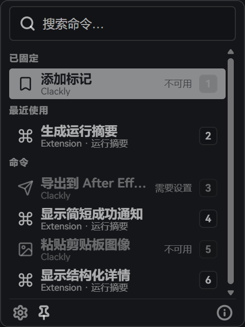

# Clackly

[English](README.en.md)

Clackly 是 DaVinci Resolve Studio 内的轻量命令面板。

[下载 Windows 版](https://github.com/Wutpeach/Clackly/releases/latest) · [使用文档](https://wutpeach.github.io/Clackly/docs/) · [官网](https://wutpeach.github.io/Clackly/)

  

## 能做什么

- 搜索内置命令、扩展和 Resolve 脚本。
- 固定常用命令，找回最近用过的操作。
- 安装 Python 扩展，把自己的工具放进面板。

## 开始使用

目前支持 **Windows x64** 和 **DaVinci Resolve Studio**。

1. 下载并运行 [Windows 安装器](https://github.com/Wutpeach/Clackly/releases/latest)。
2. 在 Resolve 的 **Workspace → Workflow Integrations → Clackly** 中加载插件。

完整步骤见[安装指南](https://wutpeach.github.io/Clackly/docs/install/)和[首次使用](https://wutpeach.github.io/Clackly/docs/first-use/)。

## 开发

用官方 Developer Skill，让 AI 帮你写 Python 扩展。

[制作扩展](https://wutpeach.github.io/Clackly/docs/developer/) · [应用开发](resolve-command-center/README.md)
